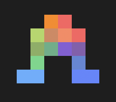
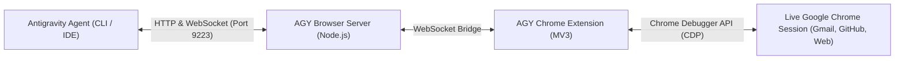

<div align="center">



# ⚡ AGY Browser Relay

### Supercharge Antigravity & AI Agents with Real Chrome Control
**Control your actual, daily-driver Google Chrome session via native Chrome DevTools Protocol (CDP). No bot detection. No headless lockouts. 100% human authenticity.**

[](https://github.com/xmahbub/agy-browser-relay/stargazers)
[](LICENSE)
[](agy-browser-extension)
[](skills/agy-browser)
[](https://nodejs.org)

[Features](#-key-features) • [Quick Start](#-quick-start-1-minute) • [Antigravity Integration](#-antigravity-integration) • [Showcase](#-proven-in-action) • [Architecture](#-architecture)

---

</div>

## 💡 Why AGY Browser Relay?

Most agent web-browsing solutions rely on headless Puppeteer/Playwright instances. They get instantly flagged by Cloudflare, reCAPTCHA, and Google logins.

**AGY Browser Relay is different.** It connects directly to your **existing, logged-in Chrome browser** using a lightweight Manifest V3 extension and a local WebSocket bridge.

| Feature | Standard Headless / Playwright | ⚡ AGY Browser Relay |
| :--- | :---: | :---: |
| **Logged-in Profiles** (Gmail, GitHub, X) | ❌ Stored cookies get wiped / blocked | ✅ Uses your live active profiles |
| **Anti-bot & Cloudflare Detection** | ❌ Fails bot challenges | ✅ 100% genuine browser footprint |
| **Google Lens & File Drag-and-Drop** | ❌ Complex file mocking | ✅ Seamless native file upload |
| **Zero Setup Latency** | ❌ Spawns slow Chromium forks | ✅ Instantly commands open tabs |
| **Antigravity CLI / IDE Ready** | ❌ Manual script integration | ✅ Built-in `/browser` skill support |

---

## ✨ Key Features

- 🎯 **Native Chrome DevTools Protocol (CDP)**: Full access to DOM tree, selector resolution, evaluate JavaScript, click, type, and screenshot.
- 📬 **Live Web Automation**: Read & write emails on Gmail, interact with GitHub, perform Google Lens image lookups, fill dynamic forms.
- 🔄 **Always-On Daemon**: Includes macOS `launchd` service configuration so the relay starts automatically on system boot.
- 🧩 **First-Class Antigravity Skill**: Ships with `skills/agy-browser/SKILL.md` ready to drop into `~/.gemini/config/skills/agy-browser/`.
- 🔒 **Local & Private**: All communication happens strictly on `127.0.0.1:9223` between your terminal and Chrome. No third-party servers.

---

## 🚀 Quick Start (1 Minute)

### Option 1: Automated 1-Click Install

Clone the repository and run the installer:

```bash
git clone https://github.com/xmahbub/agy-browser-relay.git
cd agy-browser-relay
./install.sh
```

The installer will:
1. Install Node.js dependencies for the relay server.
2. Register and install the `agy-browser` skill into `~/.gemini/config/skills/agy-browser/`.
3. Configure the `launchd` auto-start daemon (macOS) so the server runs on port `9223`.

### Option 2: Load the Chrome Extension

1. Open Google Chrome and navigate to `chrome://extensions`.
2. Enable **Developer mode** (toggle in top right).
3. Click **Load unpacked** and select the [`agy-browser-extension/`](agy-browser-extension) folder.
4. Pin the **AGY Browser Relay** extension icon. It will connect to `ws://127.0.0.1:9223` automatically!

---

## 🤖 Antigravity Integration

Once installed, Antigravity AI agents can naturally browse the web through your Chrome tabs.

Whenever an agent needs to perform browser automation, it activates the `agy-browser` skill:

```bash
# Check running tabs
curl -s http://127.0.0.1:9223/tabs

# Open a new tab
curl -s -X POST http://127.0.0.1:9223/open -H "Content-Type: application/json" -d '{"url":"https://gmail.com"}'

# Execute script or CDP commands via WebSocket / HTTP bridge
```

You can also invoke it directly with the `/browser` slash command in your chat interface!

---

## 🔥 Proven in Action

Here are real tasks performed by Antigravity using **AGY Browser Relay**:

1. **Google Lens Image Search**:
   - Agent uploaded a local potato photo from `~/Downloads/potato.jpeg` straight into Google Lens.
   - Retrieved real-time visual matches, recipes, and botanical classifications.
2. **Gmail Automation**:
   - Opened Gmail in the user's active session.
   - Composed an email with custom subject & body, attached the downloaded file, and delivered it—bypassing 2FA and bot checks.
3. **Private GitHub Repository Creation**:
   - Interacted with GitHub's React UI to create and configure a new private repository and pushed local source code directly.

---

## 🏗️ Architecture



---

## 📁 Repository Structure

```
├── agy-browser-extension/     # Chrome Manifest V3 Extension
│   ├── manifest.json
│   ├── background.js
│   ├── popup.html
│   └── icons/
├── agy-browser-server/        # Node.js WebSocket & HTTP Relay Server
│   ├── index.js
│   └── package.json
├── skills/                    # Antigravity Agent Skill
│   └── agy-browser/
│       └── SKILL.md
├── assets/                    # Project logos, banner, and badges
│   ├── banner.png
│   └── logo.png
├── install.sh                 # 1-Click Installation & Launchd Daemon Setup
└── README.md
```

---

## 🤝 Contributing

Contributions, issues, and feature requests are welcome!
Feel free to check [issues page](https://github.com/xmahbub/agy-browser-relay/issues).

---

## 📄 License

Distributed under the MIT License. See `LICENSE` for more information.

<div align="center">
  <sub>Built with ❤️ for the Antigravity & AI Agent Community.</sub>
</div>
